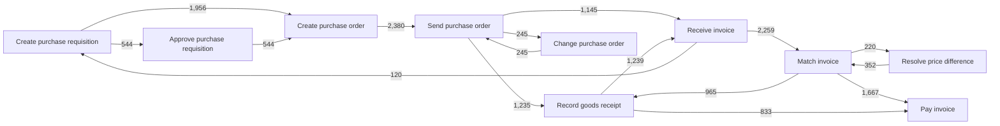
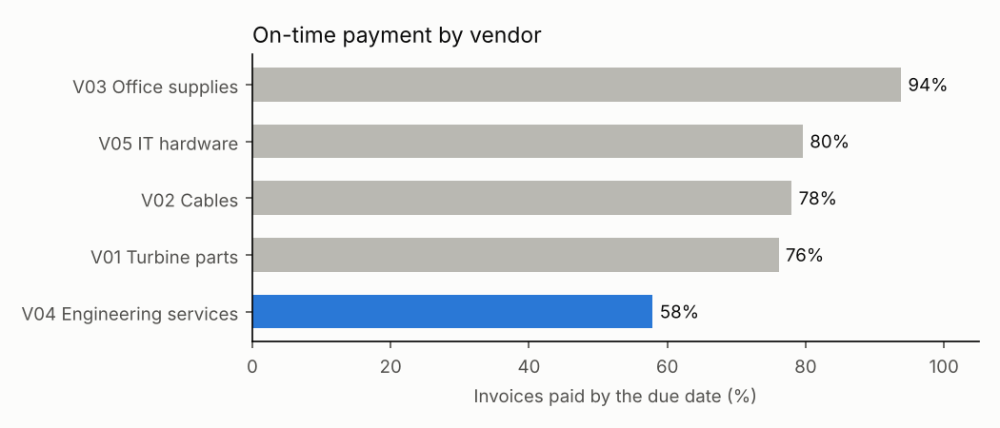

# Process mining and process KPIs: purchase to pay

Process mining on a purchase-to-pay event log: which paths the cases really take, where they break the rules, where the time goes, and what goes with late payment. The KPIs are written in SQL, so they can run on a data warehouse and feed a Power BI report. The company and the event log are fictional and generated by the code, with known deviations planted so the results can be checked.

```bash
pip install -e ".[dev]"
python -m pmkpi      # data/, powerbi/, reports/results.md
pytest               # 9 tests
```

## The data

2,500 purchase requisitions in 2025, 19,127 events, two company codes and five vendors. Each event has a case, an activity, a timestamp and a resource. Definitions of every KPI and check: [docs/kpi-definitions.md](docs/kpi-definitions.md).

## KPI overview

From [`sql/kpis.sql`](sql/kpis.sql), run on DuckDB:

| KPI | Value |
|---|---|
| Median throughput time | 31.3 days (90th percentile 58.9) |
| On-time payment | 76.9% |
| Rework rate | 22.2% |
| First-time invoice match | 85.9% |
| Automation rate (events done by the system) | 54.8% |
| Approvals taking more than 2 days | 28.7% |

## What the cases really do

36 variants. The top five cover 73% of cases. Only 68% follow the designed path. Main transitions, with case counts:



The last arrow is the one a process owner should look at first: 120 cases start with the invoice, and the requisition and order are created afterwards.

## Conformance

| Type | Check | Cases | Share |
|---|---|---|---|
| Compliance | Requisition above the approval limit without approval | 59 | 2.4% |
| Compliance | Purchase order created after the invoice | 120 | 4.8% |
| Compliance | Invoice paid before goods receipt | 60 | 2.4% |
| Rework | Price difference resolved at invoice matching | 352 | 14.1% |
| Rework | Purchase order changed after sending | 245 | 9.8% |
| | Cases with none of the above | 1,775 | 71.0% |

## What goes with late payment

| Case attribute | On time with it | On time without it |
|---|---|---|
| Price difference at matching | 60.8% | 79.5% |
| Order created after the invoice | 70.8% | 77.2% |
| Order changed after sending | 76.3% | 76.9% |



* A price difference at matching costs about 19 points of on-time payment. It is the rework worth fixing, for example with price checks when the order is created.
* Changing an order after sending it is rework too, but it happens before the invoice and does not delay payment. Not all rework deserves the same priority.
* Engineering services pay on time in only 58% of cases and take twice as long as office supplies. Company code ES01 is slower than DE01 in every group.
* Most of the waiting sits between invoice matching and payment (about 14 days median). Part of that is intended, because invoices are paid close to the due date. The question for the process owner is why 23% still miss it.

Full results, including variant and bottleneck tables: [reports/results.md](reports/results.md).

## SQL and Power BI

The KPIs are plain SQL with window functions and conditional aggregation. They run on DuckDB here, and on Snowflake after changing the date functions listed at the top of the file. `python -m pmkpi` also writes a small star schema to `powerbi/` (`fact_event`, `fact_case`, `fact_conformance`, `dim_activity`), ready to load into Power BI. The model is described in [docs/kpi-definitions.md](docs/kpi-definitions.md).

## Layout

```
src/pmkpi/eventlog.py  generated purchase-to-pay event log with planted deviations
src/pmkpi/mining.py    variants, directly-follows graph, conformance checks, bottlenecks
src/pmkpi/kpis.py      runs sql/kpis.sql on DuckDB
sql/kpis.sql           case metrics view and KPI queries
docs/                  KPI and check definitions, Power BI model
data/, powerbi/        event log and star schema from the last run
reports/               results and chart
```

## License

MIT
