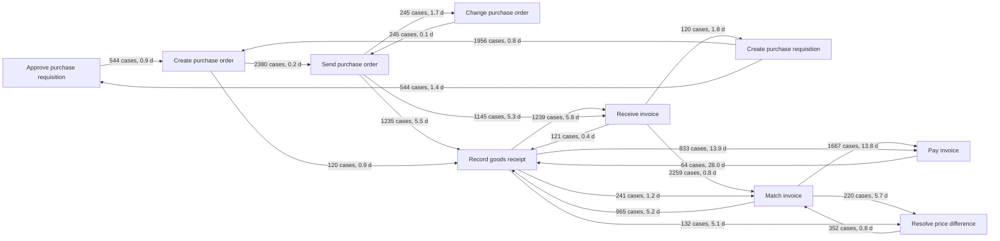
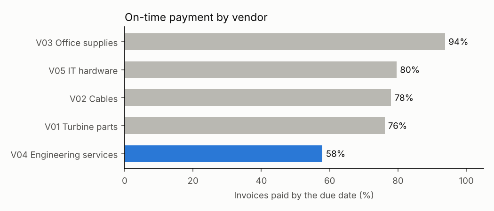

# Process mining results: purchase to pay

2,500 cases, 19,127 events, generated data for 2025. Produced by `python -m pmkpi`.

## KPI overview (SQL)

| kpi | value |
|---|---|
| cases | 2500.0 |
| median_throughput_days | 31.3 |
| p90_throughput_days | 58.9 |
| on_time_payment_rate | 0.769 |
| rework_rate | 0.222 |
| first_time_match_rate | 0.859 |
| automation_rate | 0.548 |
| approval_sla_breach_rate | 0.287 |

## Variants

36 variants. The top 5 cover 73% of cases.

| cases | share | cumulative_share | steps | variant |
|---|---|---|---|---|
| 744 | 0.298 | 0.298 | 7 | Create purchase requisition > Create purchase order > Send purchase order > Record goods receipt > Receive invoice > Match invoice > Pay invoice |
| 580 | 0.232 | 0.53 | 7 | Create purchase requisition > Create purchase order > Send purchase order > Receive invoice > Match invoice > Record goods receipt > Pay invoice |
| 211 | 0.084 | 0.614 | 8 | Create purchase requisition > Approve purchase requisition > Create purchase order > Send purchase order > Record goods receipt > Receive invoice > Match invoice > Pay invoice |
| 171 | 0.068 | 0.682 | 8 | Create purchase requisition > Approve purchase requisition > Create purchase order > Send purchase order > Receive invoice > Match invoice > Record goods receipt > Pay invoice |
| 113 | 0.045 | 0.727 | 9 | Create purchase requisition > Create purchase order > Send purchase order > Record goods receipt > Receive invoice > Match invoice > Resolve price difference > Match invoice > Pay invoice |
| 86 | 0.034 | 0.761 | 6 | Receive invoice > Create purchase requisition > Create purchase order > Record goods receipt > Match invoice > Pay invoice |
| 85 | 0.034 | 0.795 | 9 | Create purchase requisition > Create purchase order > Send purchase order > Change purchase order > Send purchase order > Record goods receipt > Receive invoice > Match invoice > Pay invoice |
| 83 | 0.033 | 0.828 | 9 | Create purchase requisition > Create purchase order > Send purchase order > Receive invoice > Match invoice > Record goods receipt > Resolve price difference > Match invoice > Pay invoice |
| 74 | 0.03 | 0.858 | 7 | Create purchase requisition > Create purchase order > Send purchase order > Receive invoice > Record goods receipt > Match invoice > Pay invoice |
| 58 | 0.023 | 0.881 | 9 | Create purchase requisition > Create purchase order > Send purchase order > Change purchase order > Send purchase order > Receive invoice > Match invoice > Record goods receipt > Pay invoice |

## Directly-follows graph (transitions with at least 50 cases)

## Conformance

| type | check | cases | share |
|---|---|---|---|
| Compliance | Requisition above the approval limit without approval | 59 | 0.024 |
| Compliance | Purchase order created after the invoice (order after the fact) | 120 | 0.048 |
| Compliance | Invoice paid before goods receipt | 60 | 0.024 |
| Rework | Price difference resolved at invoice matching | 352 | 0.141 |
| Rework | Purchase order changed after sending | 245 | 0.098 |
| Overall | Cases with none of the above | 1775 | 0.71 |

Cases that follow the designed path exactly (approval aside): 68%.

## Where the time goes

| activity | next_activity | count | median_days | total_days |
|---|---|---|---|---|
| Match invoice | Pay invoice | 1667 | 13.8 | 22970 |
| Record goods receipt | Pay invoice | 833 | 13.9 | 11561 |
| Record goods receipt | Receive invoice | 1239 | 5.8 | 7228 |
| Send purchase order | Record goods receipt | 1235 | 5.5 | 6746 |
| Send purchase order | Receive invoice | 1145 | 5.3 | 6116 |
| Match invoice | Record goods receipt | 965 | 5.2 | 5022 |
| Receive invoice | Match invoice | 2259 | 0.8 | 1873 |
| Pay invoice | Record goods receipt | 64 | 28.0 | 1794 |

## By vendor (SQL)

| vendor | cases | median_throughput_days | on_time_payment_rate | rework_rate |
|---|---|---|---|---|
| V04 Engineering services | 525 | 42.5 | 0.579 | 0.246 |
| V01 Turbine parts | 468 | 32.9 | 0.761 | 0.233 |
| V02 Cables | 500 | 32.6 | 0.78 | 0.202 |
| V05 IT hardware | 511 | 30.5 | 0.796 | 0.217 |
| V03 Office supplies | 496 | 20.8 | 0.938 | 0.214 |

## What goes with late payment

| case attribute | on time with it | on time without it | cases |
|---|---|---|---|
| Price difference at matching | 0.608 | 0.795 | 352 |
| Order after the invoice | 0.708 | 0.772 | 120 |
| Order changed after sending | 0.763 | 0.769 | 245 |

| rework | company_code | cases | on_time_payment_rate | median_throughput_days |
|---|---|---|---|---|
| no rework | DE01 | 1242 | 0.834 | 28.1 |
| no rework | ES01 | 702 | 0.734 | 34.1 |
| with rework | DE01 | 362 | 0.724 | 33.9 |
| with rework | ES01 | 194 | 0.562 | 40.9 |
